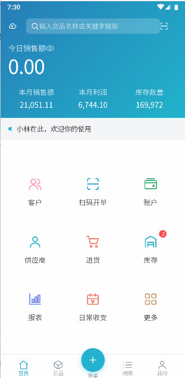
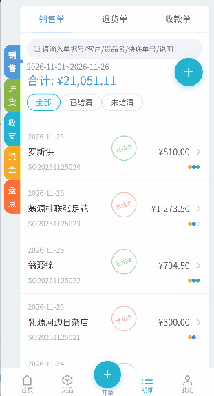
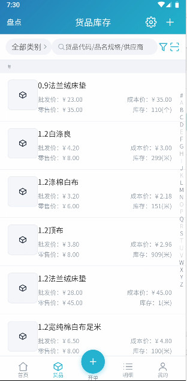
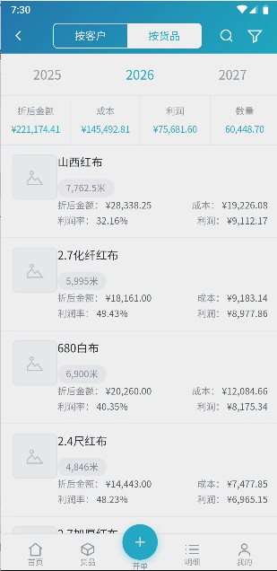
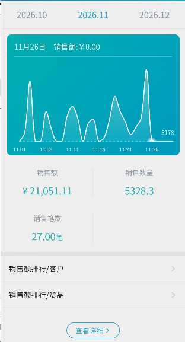
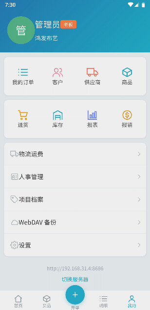
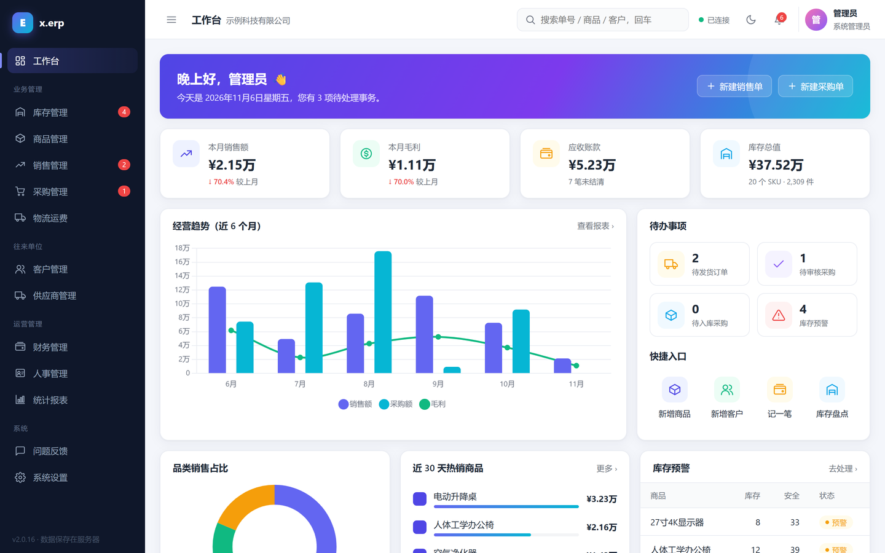
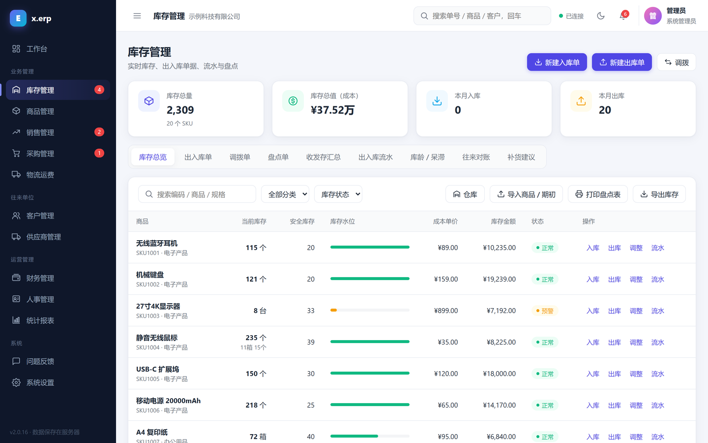
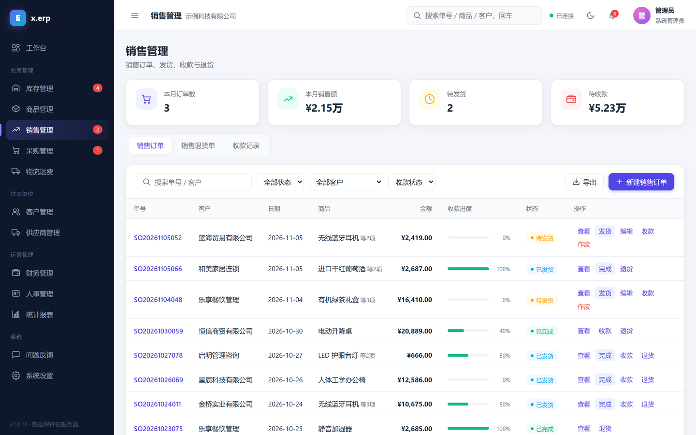
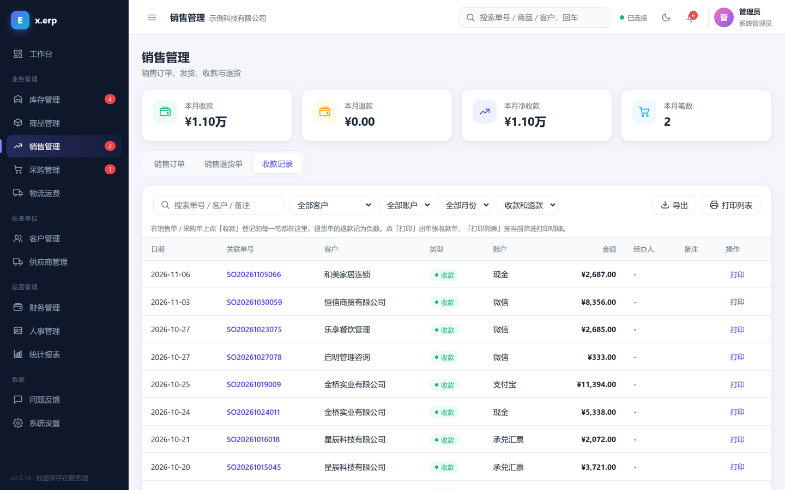

# XLerp

[](LICENSE)
[](https://github.com/desstg/XLerp/releases/latest)
[](https://hub.docker.com/r/desstg/xlerp)

**XLerp** 是一套轻量级、可自托管的进销存 / ERP 系统，面向中小企业与门店。进销存、财务、人事、报表一站搞定，**数据全部留在自己的机器里**，完全离线可用。

前端是单页应用，后端只依赖 Node.js 内置模块（数据库用内置 `node:sqlite`），所以：

- 一台 NAS（群晖、威联通、Unraid、绿联、极空间、飞牛）跑个 Docker 就能开工
- 或者任意装了 Node.js 22+ 的 Windows / Linux / macOS 机器直接 `node src/portal.js`
- 手机、平板、电脑用浏览器同时在线，界面自动适配

> **English**: XLerp is a lightweight, self-hosted inventory / ERP for small businesses — products, purchase & sales orders, returns, payments, multi-warehouse stock, finance, HR and reports. Runs on Docker (Synology, QNAP, Unraid, ZimaOS) or any machine with Node.js 22+, all data stays local in SQLite. The UI is in Simplified Chinese.

## 手机上就能用

<div align="center">
<table>
  <tr>
    <td align="center"><br><sub>首页九宫格</sub></td>
    <td align="center"><br><sub>开单 / 扫码</sub></td>
    <td align="center"><br><sub>货品库存</sub></td>
  </tr>
  <tr>
    <td align="center"><br><sub>明细流水</sub></td>
    <td align="center"><br><sub>销售统计</sub></td>
    <td align="center"><br><sub>我的</sub></td>
  </tr>
</table>
</div>

## 两种运行模式（电脑版 / 手机版都支持）

每一端都能选**数据存在哪**，两套数据完全分开、互不同步，随时切换不丢东西：

| 模式 | 数据在哪 | 适合 |
|---|---|---|
| **服务器** | 服务器上（NAS / Windows 主机 / Docker） | 多台设备共用一套账，手机开单、电脑看报表 |
| **本机单机** | 这台设备自己（浏览器 IndexedDB） | 出门没网、临时记一笔、不想连别人服务器 |

- **电脑版**：系统设置 →「数据位置」切换
- **手机版**：我的 →「数据位置」切换（列表里直接显示当前是「服务器」还是「本机单机」）
- 切换只换数据源，**不删除任何一边的账**；切回去就能看到原来的数据
- 单机账可「导出备份」成 JSON 文件，换机或重装前留一份

> 单机模式跑的是**同一份服务端业务代码**（在浏览器里执行），所以库存扣减、批次、成本核算、单据状态机、权限判断与服务器版完全一致，不是简化版。

## 电脑端

| 工作台 | 库存 |
|---|---|
|  |  |
| **销售** | **收款记录** |
|  |  |

## 快速开始

```bash
docker run -d --name xlerp --restart unless-stopped \
  -p 8686:8686 -v ./xlerp-data:/data \
  -e XERP_ADMIN_PASSWORD=你的初始密码 \
  desstg/xlerp:latest
```

浏览器打开 `http://NAS地址:8686`，账号 `admin`，密码是上面设的（不设则 `admin123`，登录后请立刻修改）。

其他安装方式和全部功能见下方各章节，或直接到 [Releases](https://github.com/desstg/XLerp/releases) 下载离线镜像 / Windows 安装包 / Android APK。

## 关于本项目

XLerp 基于开源项目 **[x.erp](https://github.com/Zyc009234/x.erp)** 二次开发，在其基础上：

- 重构了手机端界面，对齐智慧记的操作习惯（首页九宫格、开单页、货品库存、明细流水、收支记账、盘点）
- 新增销售单自动完成、采购单自动入库、开单规则统一为「打勾即自动」
- 新增开单页「其他收入 / 其他支出」统一框架，带票据影像
- 盘点单改为「点保存才建单」，避免留一堆空单
- 品牌与构建产物更名为 XLerp / `xlerp-*`

上游项目与本项目均以 AGPL-3.0 发布，感谢原作者。

## 功能

- 商品（编码、品牌、规格型号、安全库存），编码可留空自动生成；品牌支持搜索、筛选和导入导出；库存（出入库流水、安全库存预警）
- 商品分类支持父子级路径（例如「电子产品/手机」），父级改名同步子级，按父级筛选会包含全部子分类
- 入库单 / 出库单：多行明细、扫码枪录入、作废冲回；A4 / 二等分（针式）/ A5 打印，带金额大写与签字栏
- 出入库审核（可选，系统设置里按入库 / 出库分别开启）：新单先「待审核」，审核通过才改库存；驳回需填原因，制单人可一键重开
- 多单位 / 多包装条码：商品可设基本单位 + 多级包装单位（如 1 箱 = 10 中包装 = 100 盒），每级可绑定自己的条码、单独售价，并设置默认采购 / 销售单位；入库、出库、销售、采购支持直接扫包装码带出对应单位，库存与成本始终按基本单位核算，基本单位使用后锁定
- 打印模板（系统设置 → 打印模板）：各类单据可改标题（如「送货单」）、抬头地址电话、表头项目、明细列的显示 / 顺序 / 列名 / 列宽 / 对齐、签字栏、底部说明、字体、字号、LOGO 和纸张方向，带实时预览；空白表头字段和整列都为空的可选明细列不会打印
- 盘点单：建单时快照账面，扫码定位录入实盘数，审核后自动生成盘盈 / 盘亏；录入与审核权限分离；打印盘点表 / 盘点盈亏表
- 收发存汇总表：任意期间的期初、入库、出库、期末数量与金额，可打印、导出；点开商品查看明细账（逐笔结存）
- 成本核算：可选移动加权平均或先进先出（FIFO），入库自动记成本，出库按所选口径结转
- 管理员成本修正：填写原因后可修正当前商品成本，库存数量不变，历史销售成本不回写
- Excel / CSV 导入商品和期初库存：下载模板 → 填写 → 预览校验 → 导入，任何一行出错都不会写入
- 入库单 / 出库单 / 销售单 / 采购单 Excel 批量导入：按单据编号合并多行，支持不同日期和多张单据；整批校验，失败不写入
- 销售单、采购单（审核 / 发货 / 入库 / 收付款）：支持分批发货、分批入库和一张订单多次执行，发货/入库统一生成关联出入库单，库存只扣减一次；支持同一商品多行、0 元赠品行和手工修改行小计；销售订单可单独填写收货地址
- 统计报表「客户贡献」：按客户和时间段查看销售、退货、毛利及订单毛利，可导出客户汇总和订单明细
- 客户、供应商往来与应收应付，支持录入接管旧账的期初应收 / 期初应付；客户档案支持添加和删除跟进记录
- 客户 / 供应商独立收付款：可先登记预收 / 预付款，再核销到订单
- 财务收支流水、人事档案、经营报表
- 角色权限：预置仓库主管、仓管员、入库员、出库员、盘点员、商品专员、成本会计、只读查询、业务员，可新增自定义角色并逐项勾选权限（服务端校验）
- 功能模块可按需启用（默认只启用库存管理与商品管理，在 系统设置 → 常规设置 中开启其他模块）
- 操作日志
- 列表支持勾选、全选本页和批量操作：批量删除商品/客户/供应商/员工/临时送货/订单等，批量作废出入库单、调拨单、盘点单、报销和备用金，临时送货可批量标记已付
- 多仓库 + 调拨单：多个仓库 / 门店分开记库存，出入库单、盘点单、销售发货、采购入库按仓库进行，仓库之间开调拨单；收发存汇总与明细账可按仓库统计
- 多公司 / 多账套：管理员在 系统设置 → 公司管理 新建公司，每家公司使用独立数据库；登录页选择公司，登录后在顶部随时切换，商品、客户、库存、财务报表互不影响
- 项目档案：维护项目名称、状态、工期和负责人；出入库单可关联项目，按项目筛选和汇总，项目改名会同步已有单据
- 批次 / 保质期：按商品开启；入库记批号、生产日期、有效期（可按保质期天数自动计算），出库先到期先出（已过期批次不会自动发出，报损出库优先出过期批次），临期 / 过期提醒，批次随调拨走
- 条码标签打印：Code 128 条码，40×30 / 50×30 / 60×40 热敏标签或 A4 不干胶，可带品名、规格、售价
- 补货建议：按近期出库速度、到货周期、备货天数、安全库存与在途采购计算建议补货量，按供应商一键生成采购单
- 序列号：按商品开启，出入库单、调拨单逐件登记（可扫码，出库可自动选号），查每一件的入库、出库、去向
- 往来对账单：按往来单位和期间列出收发货明细，销售 / 采购模块启用时带应收应付余额，可打印给对方盖章
- 库龄 / 呆滞品分析：按先进先出估算库龄分段，标出多少天没出库的呆滞品和占压金额
- 库存提醒推送：每天定时把库存不足、临期 / 过期批次、待审核单据发到企业微信、钉钉、飞书群机器人或任意 Webhook
- 盘点可按「2箱3」录入，开启「扫码累加」后每扫一次 +1（安卓客户端连续扫码）
- 数据存于本地 SQLite，每日自动备份（保留 30 天），支持 JSON 备份导出 / 导入
- 问题反馈支持文字、粘贴或上传截图，回复会显示在客户端的「问题反馈」里
- 云服务支持扫码购买 / 续费，支付回调自动发授权码；1GB / 5GB / 10GB 三档套餐

全部功能免费使用，基于 [AGPL-3.0](LICENSE) 协议开源。

## 目录

| 路径 | 说明 |
|---|---|
| `src/server.js` | 服务端：只依赖 Node.js 内置模块，数据库使用内置 `node:sqlite` |
| `src/portal.js` | 多账套网关：全局账号、公司管理、登录后切换，每家公司启动独立服务实例 |
| `src/index.html` | 前端单页应用（由服务端提供） |
| `src/client.js` | Windows 客户端模式的本地代理：把 `/api` 转发到远程服务器（不开窗口，窗口由 `src/desktop` 负责） |
| `src/desktop/` | Windows 桌面外壳（Electron）：原生窗口、托盘、启动闪屏、拉起本机服务 |
| `windows/` | Windows 安装包（Inno Setup）：源码 + 脚本 + 中文语言文件 |
| `tests/` | 后端接口与多账套测试（`node --test "tests/*.test.mjs"`） |
| `fnos/` | 飞牛 fnOS 应用打包（manifest、生命周期脚本、安装向导） |
| `Dockerfile`、`docker-compose.yml` | Docker 镜像（见下方「Docker 部署」） |

## 直接运行

需要 Node.js 22.13+（22.5–22.12 需加 `--experimental-sqlite`）：

```bash
node src/portal.js --data ./data --port 8686
```

浏览器打开 `http://127.0.0.1:8686`，默认账号 `admin` / `admin123`，首次登录后请立即修改。网关会从 `9001` 起为各公司分配本机内部端口，可用 `--base-port 9100` 改起始端口；这些内部端口只监听 `127.0.0.1`。

## Docker 部署（群晖 / 威联通 / Unraid / 绿联 / 极空间等）

镜像在 Docker Hub：[`desstg/xlerp`](https://hub.docker.com/r/desstg/xlerp)（群晖 Container Manager、威联通 Container Station、绿联、极空间的镜像仓库里搜 `xlerp` 就能找到），支持 amd64 和 arm64。数据全部在容器的 `/data` 目录（数据库、每日自动备份、日志），挂载出来后升级镜像不丢数据。

```bash
docker run -d --name xlerp --restart unless-stopped \
  -p 8686:8686 -v ./xlerp-data:/data \
  -e XERP_ADMIN_PASSWORD=你的初始密码 \
  desstg/xlerp:latest
```

或者用 `docker-compose.yml`（新建一个文件，内容如下，然后 `docker compose up -d`）：

```yaml
services:
  xlerp:
    image: desstg/xlerp:latest
    container_name: xlerp
    restart: unless-stopped
    ports:
      - "8686:8686"
    volumes:
      - ./xlerp-data:/data
    environment:
      - XERP_ADMIN_PASSWORD=你的初始密码   # 首次启动的管理员密码，不设则 admin123
      - XERP_STATS_URL=                    # 留空关闭匿名使用统计
      - TZ=Asia/Shanghai
    healthcheck:
      test: ["CMD", "node", "-e", "fetch('http://127.0.0.1:8686/api/ping').then(r=>process.exit(r.ok?0:1)).catch(()=>process.exit(1))"]
      interval: 30s
      timeout: 5s
      start_period: 20s
      retries: 3
```

浏览器打开 `http://NAS地址:8686`，账号 `admin`，密码是 `XERP_ADMIN_PASSWORD`（不设置则为 `admin123`，登录后请及时修改；这个变量只在第一次启动时生效）。

- **升级**：`docker pull desstg/xlerp:latest` 后重建容器（compose：`docker compose pull && docker compose up -d`）
- **国内拉不动 Docker Hub**：到 [Releases](https://github.com/desstg/XLerp/releases/latest) 或官网下载离线镜像包 `xlerp-<版本>-docker-amd64.tar.gz`（ARM 设备用 `arm64`），执行 `docker load -i xlerp-<版本>-docker-amd64.tar.gz` 导入，之后同上
- **环境变量**：`XERP_ADMIN_PASSWORD` 首次启动的管理员密码；`XERP_STATS_URL=`（留空）关闭匿名使用统计，也可以在 系统设置 里关；`TZ` 默认 `Asia/Shanghai`
- **Unraid**：Docker 页面底部的 Template Repositories 里加上 `https://github.com/desstg/XLerp` 并保存，然后 Add Container → Template 选 XLerp；模板见 [`unraid/xerp.xml`](unraid/xerp.xml)
- **CasaOS / ZimaOS**：已提交到官方应用商店，上架后在应用商店搜索 XLerp 即可安装
- 镜像由 [GitHub Actions](.github/workflows/docker.yml) 在每次发版时自动构建

## 测试

`tests/` 下是后端接口测试：在临时目录启动一个真实服务端，覆盖出入库、成本、多单位、盘点、出入库审核与权限。发版前跑一遍：

```bash
node --test tests/api.test.mjs
```

在线演示模式另有测试：`node --test tests/demo.test.mjs`。

## 在线演示模式

设置环境变量 `XERP_DEMO=1` 启动即为公开演示版：默认打开全部模块，登录页给出演示账号，顶部常驻提示条；屏蔽改密码、账号和角色管理、推送、快递鸟、导入备份 / 清空、问题反馈。部署在本机反向代理后面时按 `X-Forwarded-For` 区分访客。数据重置交给部署侧，见 `tools/demo-server/xerp-demo.service`（每小时重启并清空数据目录）。

## Windows 安装版

从 [Releases](https://github.com/desstg/XLerp/releases) 下载 `xlerp-<版本>-windows-x64-setup.exe`（Windows 10 / 11 64 位），双击安装：

- 装完桌面和开始菜单都有 **小林进销存**，点开是**程序自己的窗口**（Electron 原生窗口，不是浏览器标签页），有独立图标、任务栏按钮和托盘
- 安装向导里先选**运行模式**：
  - **服务器模式** — 数据存这台电脑，手机、别的电脑都可以连它
  - **客户端模式** — 连一台已经装好的服务器（比如 NAS），本机不存业务数据
- 再设端口（默认 8686）、管理员密码、数据目录
- 后台服务照旧运行（任务计划程序「XLerp」，SYSTEM 身份开机自启，崩溃自动重启），手机和局域网其他电脑连的就是它，不用登录 Windows；桌面窗口关了服务还在跑
- 自动在防火墙放行该端口，仅限同一局域网；局域网其他电脑访问 `http://本机IP:8686`
- 数据默认在 `C:\ProgramData\XERP`（可改到别的盘）；覆盖安装新版即可升级，升级和卸载都不删数据
- 静默安装：`setup.exe /SILENT /SUPPRESSMSGBOXES /NORESTART`，用默认值（服务器模式、8686），管理员密码可用环境变量 `XERP_ADMIN_PASSWORD` 指定

**两种模式之外，还能切「数据位置」**：装好之后，系统设置 →「数据位置」可以在「服务器」和「本机单机」之间切换（见上文「两种运行模式」）。

安装包约 109 MB，包含 Electron 运行时和 Node.js，不依赖系统里的浏览器。

构建：`powershell -ExecutionPolicy Bypass -File windows\build-windows.ps1`（需要 x64 Node.js 22.13+ 和 Inno Setup 6：`winget install JRSoftware.InnoSetup`），产物为 `dist\xlerp-<版本>-windows-x64-setup.exe`。构建时会自动下载 Electron 运行时（npmmirror 优先，失败退回 GitHub）。

## macOS 版

下载 `XLerp-<版本>-macOS-arm64.dmg`（Apple Silicon：M1/M2/M3/M4），双击打开后把 **小林进销存** 拖进「应用程序」。

**首次打开要右键 →「打开」**（程序没有 Apple 开发者签名，直接双击会被 Gatekeeper 拦下）。只想双击打开的话，先在「终端」里跑一次：

```bash
xattr -dr com.apple.quarantine /Applications/XLerp.app
```

Intel Mac 怎么办：

- 装 [Rosetta 2](https://support.apple.com/zh-cn/HT211861)（`softwareupdate --install-rosetta`）后可以直接跑 arm64 版
- 或者自己构建 x64 版，见下方「构建」

和 Windows 版一样的两种运行模式（服务器 / 本机单机），切换在「系统设置 → 数据位置」。数据默认存在 `~/Library/Application Support/XERP`（时间机器备份会自动带上）。

构建（需要 macOS + Node.js 22）：

```bash
chmod +x mac/build-mac.sh
./mac/build-mac.sh                      # 按当前机器架构构建
TARGET_ARCH=x64 ./mac/build-mac.sh      # 强制构建 Intel 版
```

产物为 `dist/XLerp-<版本>-macOS-<arch>.dmg`，同时生成 `.sha256` 校验文件。CI 上由 `.github/workflows/macos.yml` 自动构建（推 `v*` 标签或手动触发，产物自动传到对应 Release）。

## 安卓客户端

下载 `xlerp-<版本>-android.apk`（Android 7.0 及以上）安装。

**装上直接就能用（默认单机模式）**：第一次打开会让你填公司名、管理员账号和密码，建完账套就能开单记账，**不需要连任何服务器**，数据存在手机里。

想连服务器记账：

- 我的 →「数据位置」→ 点「服务器」→ 填服务端地址（或点「自动查找」扫局域网）
- 连上后手机和电脑共用一套账

我的页最下面常驻显示当前是「服务器 · 192.168.31.4:8686」还是「本机单机 · 数据存在这台设备里」，一眼能看出数据在哪。

其他：

- 右下角扫码按钮：用摄像头扫商品条码 / 二维码（EAN-13/8、UPC、Code 128/39/93、ITF、Codabar、QR、Data Matrix），结果填进当前输入框并自动回车，开出入库单、盘点、搜索都能用；没有选中输入框时直接查这个商品的库存
- 导出的 CSV / 备份 / 导入模板会让你选择保存位置；导入时可从手机选文件；单据、标签可走手机的系统打印（打印机或另存 PDF）
- 返回键先关弹窗，再后退
- **服务器模式下**页面来自服务端，服务端升级后手机端界面自动更新，一般不用重装 App
- **单机模式下**界面是打包在 APK 里的，数据存手机本地，完全不联网也能用；换机或重装前记得在「数据位置」里「导出备份」

APK 约 1.2 MB（含单机模式的内置界面和 Excel 组件）。

构建（不需要 Gradle / Android Studio）：`powershell -ExecutionPolicy Bypass -File android\build-android.ps1`，需要 JDK 17+ 和 Android SDK（`platforms;android-36`、`build-tools;36.1.0`）。签名密钥首次构建时生成在 `%USERPROFILE%\.xerp-android\`，请备份——换了密钥就不能覆盖安装升级。

## 离线使用

完全离线可用：服务端只用 Node.js 内置模块和内置 SQLite，前端用到的图表（Chart.js）和 Excel 导入（SheetJS）组件放在 `src/vendor/` 随程序发布。

## 飞牛 fnOS 应用

构建（Windows，需 Node.js；首次运行会自动下载官方 [fnpack](https://developer.fnnas.com/docs/cli/fnpack/)）：

```powershell
powershell -ExecutionPolicy Bypass -File fnos\build-fnos.ps1
```

产物为 `dist\xlerp-<版本>.fpk`，在飞牛 Web 界面 → 应用中心 → 手动安装。

- 依赖飞牛官方运行环境 `nodejs_v22`（安装时自动安装），包本身为纯 JS，x86 / ARM 通用
- 安装向导中设置管理员密码
- 数据目录为应用数据目录（`/vol*/@appdata/xerp`，包名沿用上游标识以便升级），升级不丢失
- `fnos/fix-fpk.js` 用于修正 Windows 上 fnpack 打包后的文件权限与换行

发布新版本时修改 `fnos/pkg/manifest` 中的 `version` 与 `changelog`。

### 上架飞牛应用中心

参见 [官方上架文档](https://developer.fnnas.com/docs/quick-started/publish-application/)：目前通过飞牛官网的微信群联系社区主理人，加入“应用中心开发者先锋交流群”后提交 `.fpk`、图标、真实界面截图与测试材料。


## 许可证

Copyright (C) 2026 desstg

XLerp 以 [GNU Affero General Public License v3.0](LICENSE)（AGPL-3.0）发布：

- 个人、企业都可以免费使用，包括商用，可以自由修改
- 如果分发修改后的版本，或者把修改后的版本做成在线服务给别人用，必须以同样的 AGPL-3.0 协议公开修改后的完整源码，并保留原作者的版权声明
- 软件按“现状”提供，不附带任何担保

如需不受 AGPL 约束的商业授权，请通过 [GitHub Issues](https://github.com/desstg/XLerp/issues) 联系作者。
