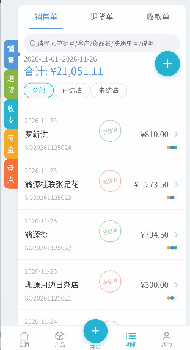
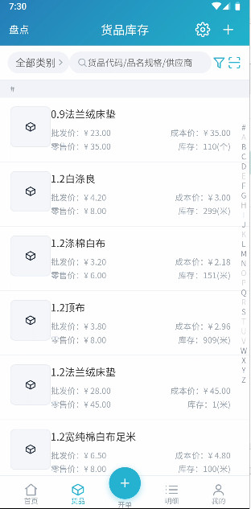
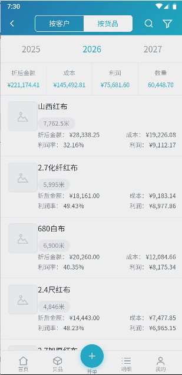
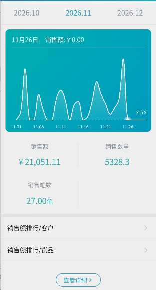
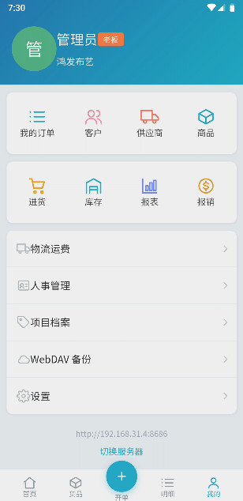

# XLerp 2.21.1

轻量级自托管进销存 / ERP，数据留在自己机器里，完全离线可用。

## 手机上就能用

<div align="center">
<table>
  <tr>
    <td align="center"><br><sub>首页九宫格</sub></td>
    <td align="center"><br><sub>开单 / 扫码</sub></td>
    <td align="center"><br><sub>货品库存</sub></td>
  </tr>
  <tr>
    <td align="center"><br><sub>明细流水</sub></td>
    <td align="center"><br><sub>销售统计</sub></td>
    <td align="center"><br><sub>我的</sub></td>
  </tr>
</table>
</div>

## 下载

| 平台 | 文件 | 说明 |
|---|---|---|
| Docker（AMD64） | `xlerp-2.20.4-docker-amd64.tar.gz` | 群晖、威联通、Unraid、绿联、极空间、飞牛等 x86 NAS |
| Docker（ARM64） | `xlerp-2.20.4-docker-arm64.tar.gz` | 树莓派、ARM 架构 NAS |
| Windows | `xlerp-2.21.1-windows-x64-setup.exe` | Windows 10 / 11 64 位，双击安装，自带 Node.js |
| Android | `xlerp-2.21.1-android.apk` | Android 7.0 及以上 |

在线拉取镜像：`desstg/xlerp:latest`（amd64 + arm64 多架构）

## Docker 快速开始

```bash
docker run -d --name xlerp --restart unless-stopped \
  -p 8686:8686 -v ./xlerp-data:/data \
  -e XERP_ADMIN_PASSWORD=你的初始密码 \
  desstg/xlerp:latest
```

浏览器打开 `http://NAS地址:8686`，账号 `admin`，密码是上面设的（不设则 `admin123`，登录后请立刻修改）。

或者用 compose（`docker-compose.yml`，保存后 `docker compose up -d`）：

```yaml
services:
  xlerp:
    image: desstg/xlerp:latest
    container_name: xlerp
    restart: unless-stopped
    ports:
      - "8686:8686"
    volumes:
      - ./xlerp-data:/data
    environment:
      - XERP_ADMIN_PASSWORD=你的初始密码
      - XERP_STATS_URL=
      - TZ=Asia/Shanghai
    healthcheck:
      test: ["CMD", "node", "-e", "fetch('http://127.0.0.1:8686/api/ping').then(r=>process.exit(r.ok?0:1)).catch(()=>process.exit(1))"]
      interval: 30s
      timeout: 5s
      start_period: 20s
      retries: 3
```

**国内拉不动 Docker Hub** 时用离线镜像包：

```bash
docker load -i xlerp-2.20.4-docker-amd64.tar.gz
docker run -d --name xlerp --restart unless-stopped \
  -p 8686:8686 -v ./xlerp-data:/data \
  -e XERP_ADMIN_PASSWORD=你的初始密码 \
  desstg/xlerp:latest
```

## Windows 安装

双击 `xlerp-2.21.1-windows-x64-setup.exe`，向导第一步选运行模式（服务器 / 客户端），再设端口（默认 8686）、管理员密码、数据目录。

装完桌面和开始菜单都有 **小林进销存**，点开就是程序自己的窗口（不是浏览器标签页）。

- **桌面窗口** `XLerp.exe`：原生窗口，有自己的图标、任务栏、标题栏和托盘；可最小化到托盘，关掉再点图标就重开
- **后台服务**：任务计划程序「XLerp」，SYSTEM 身份开机自启、崩溃自动重启，手机和局域网电脑连的就是它，不用登录 Windows
- 服务器模式数据在本机；客户端模式数据在对方服务器上，本机只做显示
- 自动在防火墙放行该端口，仅限同一局域网
- 数据默认在 `C:\ProgramData\XERP`（安装时可改到别的盘），升级和卸载都不删数据
- 静默安装：`setup.exe /SILENT /SUPPRESSMSGBOXES /NORESTART`，用默认值（服务器模式、8686）；管理员密码可用环境变量 `XERP_ADMIN_PASSWORD` 指定

## Android 安装

安装 `xlerp-2.21.1-android.apk`，手机连上和服务端同一个 Wi-Fi，首次打开填服务端地址，或点「自动查找」扫描局域网。

- 右下角扫码按钮支持 EAN-13/8、UPC、Code 128/39/93、ITF、Codabar、QR、Data Matrix
- 扫到的码会填进当前输入框并自动回车，开出入库单、盘点、搜索都能用
- 服务端升级后手机端界面自动更新，一般不用重装

> **签名说明**：本版起使用正式密钥签名，可正常覆盖升级。如果你装过 2.20.4 的早期测试包（临时证书签的），需要先卸载再装。

## 本版更新（2.21.1）

**修客户端模式看不到数据、安装包自动留副本**

- **客户端模式窗口连错端口**：安装器传的 `--port=8686` 是服务器模式的服务端口，桌面程序却把它当成客户端代理端口，去 ping `8686/local/ping` 失败后，就起了一个本机临时实例，窗口连上空库——看起来像数据丢了。现在客户端模式固定用 18686。
- **客户端模式不再用本机空库冒充服务器**：连不上远端时明确报错，提示检查服务器地址、端口、网络，而不是默默显示一个空库。
- **安装包自动多留两份**：构建完复制到 `D:\` 和桌面，避开从仓库目录双击安装时报「错误 5 拒绝访问」（那个目录被加了受限 ACL）。

## 上版更新（2.21.0）

**电脑版改成真正的桌面程序：不再在浏览器里打开网页**

- **程序自己的窗口**：新增 Electron 外壳（`src/desktop`）。窗口是原生窗口，有自己的图标、标题栏、任务栏按钮和系统托盘，不再是 Edge/Chrome 的 `--app=` 应用模式窗口。任务栏和 Alt+Tab 里显示的都是「小林进销存」。
- **两种模式都用原生窗口**：服务器模式窗口连 `127.0.0.1:端口`；客户端模式窗口连 `127.0.0.1:18686` 的本地代理（代理再转发到你填的服务器）。
- **后台服务不变**：计划任务 `XLerp` 照旧负责开机自启和给手机、别的电脑供货；桌面程序只负责开窗，两者共用同一个数据目录和端口，同时运行不冲突。
- **快捷方式改名**：桌面和开始菜单都叫「小林进销存」，指向 `XLerp.exe`。
- **图标**：把我们的 XL 图标写进了 exe 的 Win32 资源（7 个尺寸），任务栏、Alt+Tab、资源管理器里都是我们自己的图标，不是 Electron 默认蓝球。
- **启动闪屏**：双击后先显示带图标的启动画面，服务就绪再切到主窗口，不会有白屏。
- **关窗不退出**：关掉窗口后台服务还在跑，手机照样能用；要完全退出从托盘菜单「退出」。
- **安装包变大**：24 MB → 109 MB，多出来的是 Electron 运行时（保证窗口属于本程序，不依赖系统里的浏览器）。
- **静默安装**：`/SILENT` 时自动跳过模式页和设置页，用默认值；CI 和批量部署不再卡住。

**修掉的两个启动问题**

- `--server http://ip:port` 这种空格分隔的写法会被 Chromium 当成非法开关，进程直接退出（exit -1）。启动参数统一改成 `--key=value`。
- `resources\app.asar` 模式下 `APP_DIR` 用 `__dirname` 推算会多退一层，导致找不到 `portal.js` / `client.js`。改成取 `process.execPath` 所在目录。

## 上版更新（2.20.4）


**修复 v2.20.3 的三个安装问题，两个模式现在都能正常装**

- **修客户端模式装了不生效**：服务脚本里内部变量 `$mode` 和参数 `$Mode` 是同一个变量（PowerShell 不区分大小写），安装时传的 `client` 被覆盖成 `server`，导致选了客户端模式实际还是服务器模式。已把内部变量改名为 `$runMode`。
- **修安装向导编译失败**：`TInputOptionWizardPage` 没有 `Selected` 属性，改用 `Values[1]`，并默认选中「服务器模式」。
- **修客户端模式登录卡在「登录中…」**：`client.js` 读请求体时死等 `end` 事件，浏览器 fetch 可能等不到，加了 `readableEnded` 判断和 5 秒保底超时。

## 上版更新（2.20.3）

- Windows 安装时可选择运行模式：服务器模式（数据存本机）/ 客户端模式（连已有服务器）
- 数据目录可自定义：安装时能改成 `D:\XERP` 等非系统盘路径，升级沿用原目录
- 工作台显示当前运行模式：客户端模式蓝色徽章、服务器模式绿色徽章，鼠标悬停看服务器地址
- 进货统计改成与销售统计同款界面
- 手机端客户/供应商新增「专属价」入口
- 商品图在列表、详情、购物车都能正常显示，默认图换成灰蓝山形
- 单据详情页上传票据影像不再闪屏
- 新装系统默认开启全部功能模块

## 功能

- 商品 / 库存 / 多仓库 / 批次保质期 / 序列号 / 多单位与包装条码
- 入库出库单、销售单、采购单、退货单，支持审核流程、自动发货、自动入库
- 销售单自动完成：已发货 + 已付清 + 无退货，满 N 天自动置为「已完成」
- 盘点单、调拨单、收发存汇总、库龄分析、补货建议
- 客户供应商往来、应收应付、对账单、独立收付款
- 财务收支、报销审批、人事档案、统计报表
- 角色权限、操作日志、多公司多账套
- 手机端：开单、扫码、货品库存、明细、收支、盘点

完整列表见 [README](https://github.com/desstg/XLerp#功能)。

## 关于本项目

XLerp 基于开源项目 **[x.erp](https://github.com/Zyc009234/x.erp)** 二次开发，在其基础上：

- 重构了手机端界面（首页九宫格、开单页、货品库存、明细流水、收支记账、盘点）
- 新增销售单自动完成、采购单自动入库
- 开单规则统一为「打勾即自动」
- 新增开单页「其他收入 / 其他支出」统一框架，带票据影像
- 盘点单改为「点保存才建单」，避免留一堆空单
- 品牌与构建产物更名为 XLerp / `xlerp-*`

上游项目与本项目均以 AGPL-3.0 发布，感谢原作者。

## 数据安全

- 数据全部存在本地 SQLite（容器 `/data` 或 `C:\ProgramData\XERP`），不上传任何服务器
- 每日自动备份，保留 30 天
- 支持 JSON 备份导出 / 导入
- 完全离线可用，不依赖外部服务

## 许可证

AGPL-3.0
