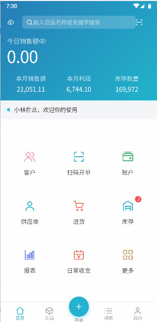

# XLerp 2.20.0

轻量级自托管进销存 / ERP，数据留在自己机器里，完全离线可用。

## 手机上就能用

<div align="center">
<table>
  <tr>
    <td align="center"><br><sub>首页九宫格</sub></td>
    <td align="center"><br><sub>开单 / 扫码</sub></td>
    <td align="center"><br><sub>货品库存</sub></td>
  </tr>
  <tr>
    <td align="center"><br><sub>明细流水</sub></td>
    <td align="center"><br><sub>销售统计</sub></td>
    <td align="center"><br><sub>我的</sub></td>
  </tr>
</table>
</div>

## 下载

| 平台 | 文件 | 说明 |
|---|---|---|
| Docker（AMD64） | `xlerp-2.20.0-docker-amd64.tar.gz` | 群晖、威联通、Unraid、绿联、极空间、飞牛等 x86 NAS |
| Docker（ARM64） | `xlerp-2.20.0-docker-arm64.tar.gz` | 树莓派、ARM 架构 NAS |
| Windows | `xlerp-2.20.0-windows-x64-setup.exe` | Windows 10 / 11 64 位，双击安装，自带 Node.js |
| Android | `xlerp-2.20.0-android.apk` | Android 7.0 及以上 |

在线拉取镜像：`ghcr.io/desstg/xlerp:latest`（amd64 + arm64 多架构）

## Docker 快速开始

```bash
docker run -d --name xlerp --restart unless-stopped \
  -p 8686:8686 -v ./xlerp-data:/data \
  -e XERP_ADMIN_PASSWORD=你的初始密码 \
  ghcr.io/desstg/xlerp:latest
```

浏览器打开 `http://NAS地址:8686`，账号 `admin`，密码是上面设的（不设则 `admin123`，登录后请立刻修改）。

**国内拉不动 ghcr.io** 时用离线镜像包：

```bash
docker load -i xlerp-2.20.0-docker-amd64.tar.gz
docker run -d --name xlerp --restart unless-stopped \
  -p 8686:8686 -v ./xlerp-data:/data \
  -e XERP_ADMIN_PASSWORD=你的初始密码 \
  ghcr.io/desstg/xlerp:latest
```

## Windows 安装

双击 `xlerp-2.20.0-windows-x64-setup.exe`，向导里设端口（默认 8686）和管理员密码。

- 以后台服务运行（任务计划程序「XLerp」，SYSTEM 身份开机自启，崩溃自动重启），不用登录 Windows
- 自动在防火墙放行该端口，仅限同一局域网
- 数据在 `C:\ProgramData\XERP`，升级和卸载都不删数据

## Android 安装

安装 `xlerp-2.20.0-android.apk`，手机连上和服务端同一个 Wi-Fi，首次打开填服务端地址，或点「自动查找」扫描局域网。

- 右下角扫码按钮支持 EAN-13/8、UPC、Code 128/39/93、ITF、Codabar、QR、Data Matrix
- 扫到的码会填进当前输入框并自动回车，开出入库单、盘点、搜索都能用
- 服务端升级后手机端界面自动更新，一般不用重装

> **签名说明**：本版起使用正式密钥签名，可正常覆盖升级。如果你装过 2.20.0 的早期测试包（临时证书签的），需要先卸载再装。

## 功能

- 商品 / 库存 / 多仓库 / 批次保质期 / 序列号 / 多单位与包装条码
- 入库出库单、销售单、采购单、退货单，支持审核流程、自动发货、自动入库
- 销售单自动完成：已发货 + 已付清 + 无退货，满 N 天自动置为「已完成」
- 盘点单、调拨单、收发存汇总、库龄分析、补货建议
- 客户供应商往来、应收应付、对账单、独立收付款
- 财务收支、报销审批、人事档案、统计报表
- 角色权限、操作日志、多公司多账套
- 手机端：开单、扫码、货品库存、明细、收支、盘点

完整列表见 [README](https://github.com/desstg/XLerp#功能)。

## 关于本项目

XLerp 基于开源项目 **[x.erp](https://github.com/Zyc009234/x.erp)** 二次开发，在其基础上：

- 重构了手机端界面（首页九宫格、开单页、货品库存、明细流水、收支记账、盘点）
- 新增销售单自动完成、采购单自动入库
- 开单规则统一为「打勾即自动」
- 新增开单页「其他收入 / 其他支出」统一框架，带票据影像
- 盘点单改为「点保存才建单」，避免留一堆空单
- 品牌与构建产物更名为 XLerp / `xlerp-*`

上游项目与本项目均以 AGPL-3.0 发布，感谢原作者。

## 数据安全

- 数据全部存在本地 SQLite（容器 `/data` 或 `C:\ProgramData\XERP`），不上传任何服务器
- 每日自动备份，保留 30 天
- 支持 JSON 备份导出 / 导入
- 完全离线可用，不依赖外部服务

## 许可证

AGPL-3.0
